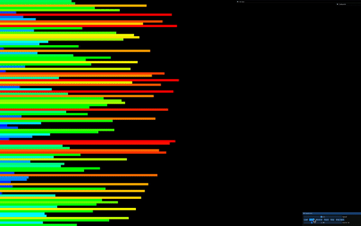

# push_swap


> *Because Swap_push isn't as natural.*

Sort a list of integers using two stacks and a limited set of operations, in as few moves as possible.
Part of the 42 Madrid common core.

**Grade: 84/100**


## The rules

You get the numbers in stack **a**, and stack **b** starts empty. These are the only moves allowed:

| Move | Effect |
|---|---|
| `sa` / `sb` / `ss` | Swap the top two elements of a, of b, or of both |
| `pa` / `pb` | Push the top of b onto a, or the top of a onto b |
| `ra` / `rb` / `rr` | Rotate up: the first element becomes the last |
| `rra` / `rrb` / `rrr` | Rotate down: the last element becomes the first |

The program prints the list of moves. At the end, b must be empty and a sorted in ascending order.

## How it sorts

- **Up to 5 numbers:** hand-written cases (`src/tiny_stack.c`) that find the minimum and place it.
- **More than 5:** every number is replaced by its index in sorted order, and then the stack goes
  through a **binary radix sort**: for each bit, from the lowest up, the numbers with a 0 go to b
  and the ones with a 1 stay in a, and then everything comes back.

Radix is simple and always correct, but it isn't the move-count optimum, which is why the grade is 84.

Input is validated: non-numeric arguments, values outside `int` and duplicates print `Error`.
Numbers can be passed as separate arguments or in a single quoted string.

## Build and run

```bash
git clone https://github.com/VolmerES/push_swap.git
cd push_swap
make
./push_swap 3 -12 8384 123 0 42
./push_swap "5 4 3 2 1"
```

## Testing and visualizing

- [push_swap_Tester](https://github.com/PepeSegura/push_swap_Tester), by a 42 Madrid peer.
- [push_swap_visualizer](https://github.com/o-reo/push_swap_visualizer), to watch both stacks move:



## Repository layout

| Path | Contents |
|---|---|
| `src/` | Moves, input parsing and checks, small-stack cases and the radix sort |
| `inc/` | `push_swap.h` |
| `libft/` | My own C library |

---

Made by **Juan Bautista Delorme** (`jdelorme`) at 42 Madrid ·
[Portfolio](https://juandelorme-portfolio.volmer.es) · [LinkedIn](https://www.linkedin.com/in/jdelorme/) · [42 intra](https://profile.intra.42.fr/users/jdelorme)
